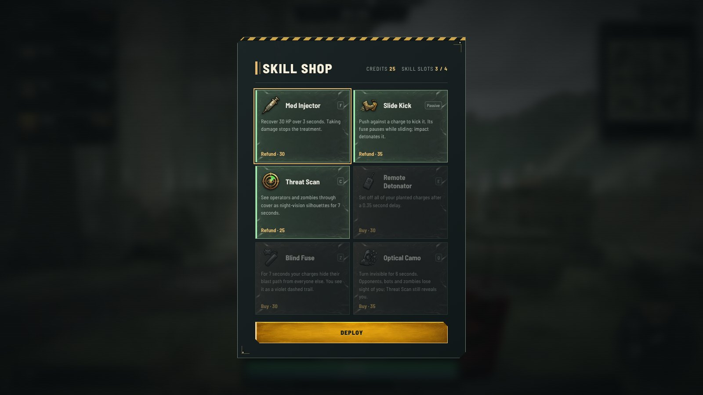

<p align="center">
  
</p>

<h1 align="center">Demolition Front (爆破前线)</h1>

<p align="center">
  A roguelite, 3D take on the classic bomb-arena game, inspired by Crazy Arcade (泡泡堂).<br />
  <a href="https://twinisland.github.io/Demolition/"><b>Play in your browser</b></a>
</p>


The idea came to me in a dream one night: what if you played Crazy Arcade in first person, and every match let you build a different character?

## The game

You are dropped into a grid arena with up to three AI opponents. Plant charges, blow open cover, and trap the others in the cross-shaped blast. The last one standing wins. If nobody has won after 180 seconds, the survivors are ranked by score.

| First person | Top-down 2D |
| --- | --- |
|  |  |
| **Match lobby** | **Skill shop** |
|  |  |

- **Bombs.** Charges explode in a cross. Blow up cover to open paths and find gear, and try not to stand in your own blast.
- **Perk drafts.** Score points to level up. Each level adds a fixed boost (more charges, health, range or power) and lets you pick one of three perks. Perks come in Silver, Gold, Diamond and Mythic tiers and stack for the rest of the match, so every run plays differently.
- **Skills.** Before each match you spend a budget on up to four skills: Remote Detonator, Med Injector, Threat Scan, Blind Fuse, Optical Camo, and Slide Kick, which sends charges sliding down a lane.
- **Gear.** Grenades, Molotovs, shields and bandages drop from cover and zombies.
- **AI opponents.** One to three bots, each with its own difficulty and skin.
- **Zombies.** They wander the arena and chase you on sight. Killing them drops gear and sometimes a gene mutation that boosts your stats.
- **Two views.** The game is first person; Classic mode plays the whole match on a top-down 2D board like the original.
- **Maps and modes.** Two maps, Outpost and Warehouse, in Free-for-All, Classic (top-down only), Wild or an untimed Practice mode.
- **Skins.** Pick a built-in operator or import any Minecraft skin PNG, and choose a finish for your charges.

## Controls

| Action | Input |
| --- | --- |
| Move, look | WASD, mouse |
| Sprint | Hold Shift |
| Jump | Space |
| Plant a charge, use or throw gear | Left click |
| Build a wooden crate | Right click |
| Skills | E, F, C, Z, Q |
| Pick a perk | 1, 2, 3 |
| Trigger an active perk / switch to the next | T / G |
| Gear wheel, supply wheel | Hold V, hold B |
| Pause | Esc |

Every key can be rebound in the in-game manual.

## Run it locally

Requires Node.js 20.19+ or 22.12+.

```sh
npm ci
npm run dev
```

## Docs and modding

Maps, skins, bomb finishes, skills, items, perks and mutations are all self-contained modules.

- [Wiki](docs/README.md): game rules, drop rates, and a page for every skill, item, perk and mutation.
- [Modding guide](docs/modding/README.md): make your own maps and content packs.
- [Developer guide](docs/developer-guide.md): working on the game itself.
- [Desktop build](docs/desktop.md): Windows and macOS apps built with Tauri, released from GitHub Actions.

## Credits

Third-party assets and their licenses are listed in [CREDITS.md](public/assets/CREDITS.md).
