<p align="center">
  
</p>

<h1 align="center">DEMOLITION FRONT · 爆破前线</h1>

<p align="center">
  <b>A first-person, roguelite take on the classic bomb-arena game.</b><br />
  Plant charges. Blow open cover. Draft a different build every match.
</p>

<p align="center">
  <a href="https://twinisland.github.io/Demolition/"></a>
  <a href="https://twinisland.github.io/Demolition/wiki/"></a>
  <a href="https://github.com/TwinIsland/Demolition/releases/latest"></a>
</p>

<p align="center">
  <a href="https://twinisland.github.io/Demolition/">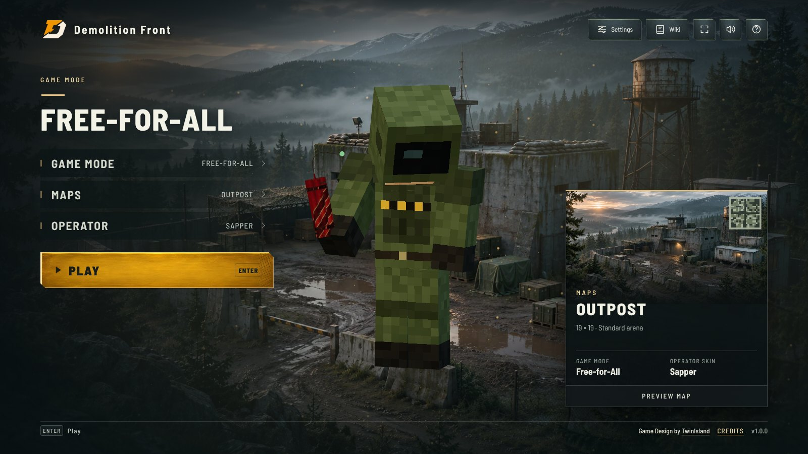</a>
</p>

The idea came to me in a dream one night: what if you played Crazy Arcade (泡泡堂) in first person, and every match let you build a different character?

You drop into a grid arena with up to three AI opponents. Charges explode in a cross, cover hides gear, a safe zone closes in, and zombies roam the lanes. The last operator standing wins.

<table>
  <tr>
    <td width="50%">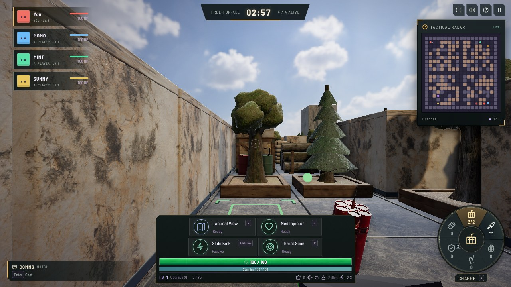</td>
    <td width="50%">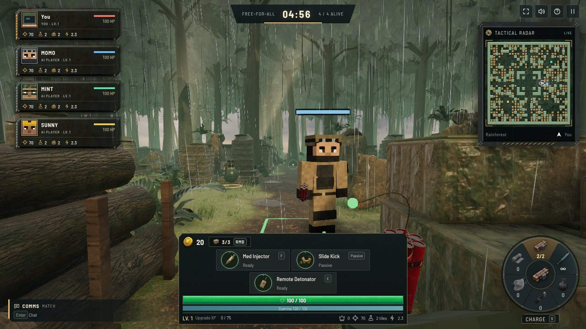</td>
  </tr>
  <tr>
    <td>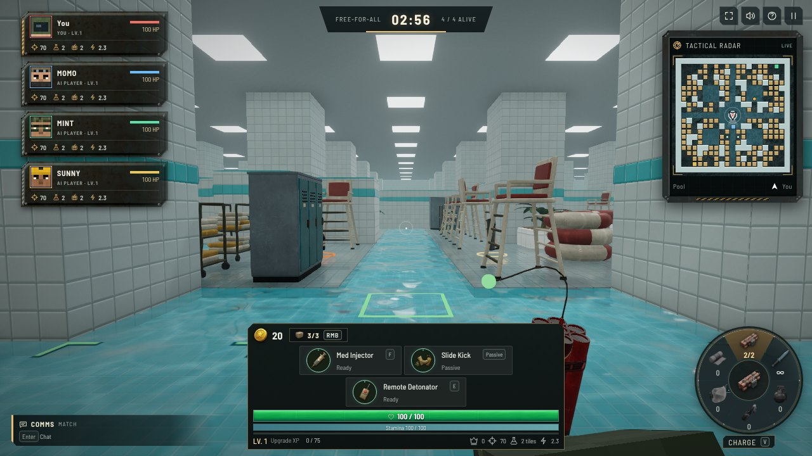</td>
    <td>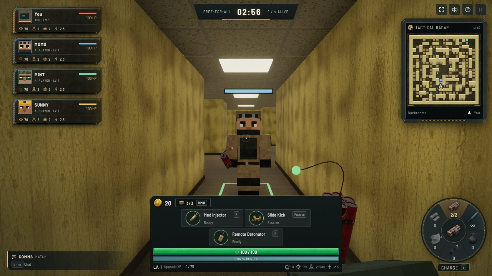</td>
  </tr>
  <tr>
    <td>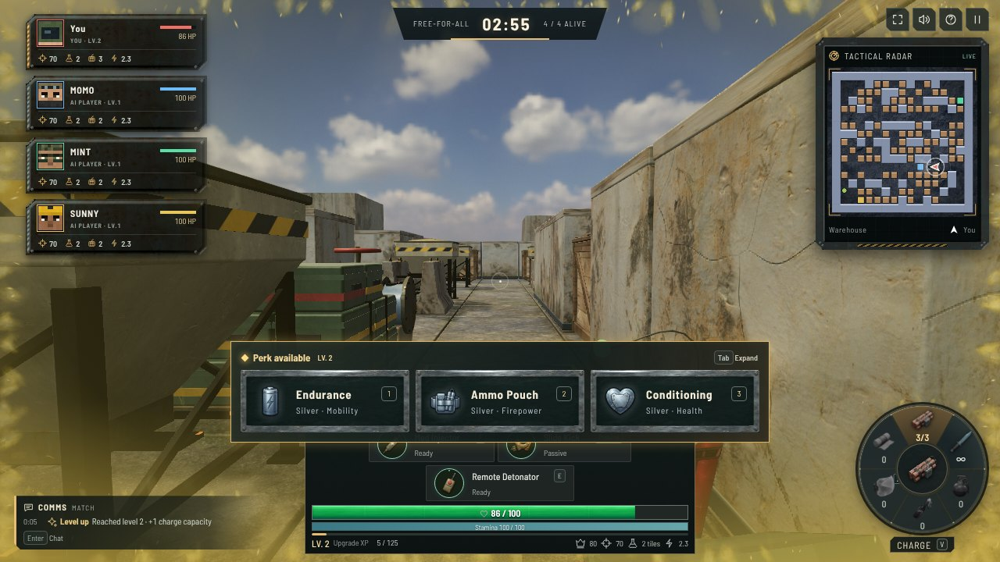</td>
    <td>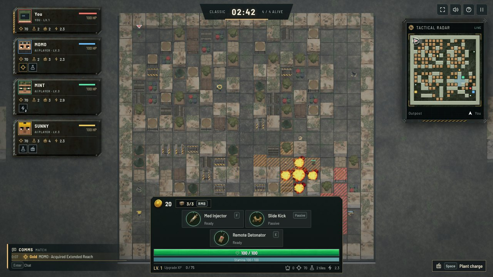</td>
  </tr>
</table>

## Five arenas

Each map has its own layout rules, weather, footsteps, ambience and soundtrack.

<table>
  <tr>
    <td width="50%">
      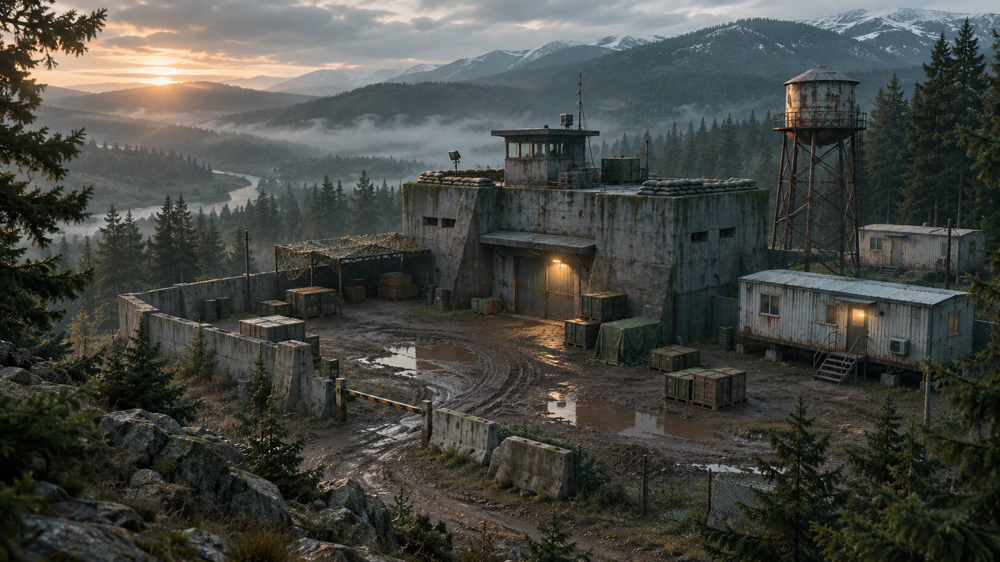<br />
      <b>OUTPOST</b> · 19 × 19<br />
      A rain-soaked forward base. The standard arena, with wet concrete that mirrors every blast.
    </td>
    <td width="50%">
      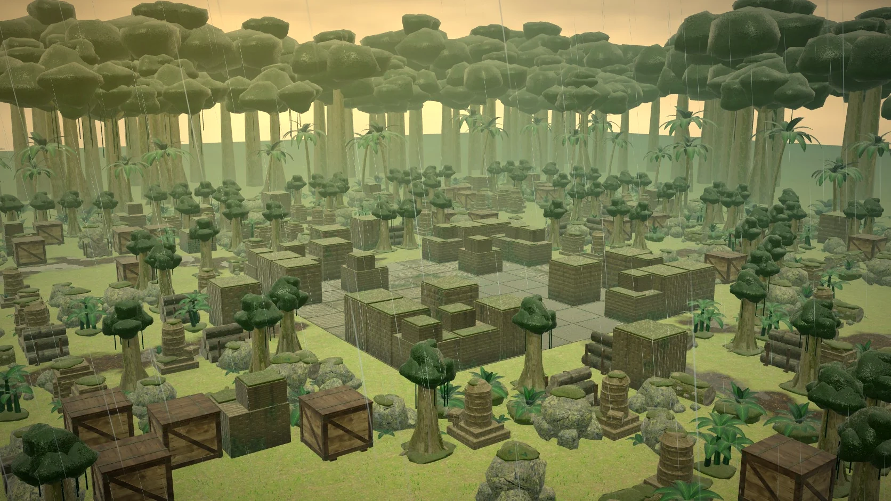<br />
      <b>RAINFOREST</b> · 31 × 31<br />
      The big one. Temple ruins under a monsoon canopy, with grass, mud and stone underfoot.
    </td>
  </tr>
  <tr>
    <td>
      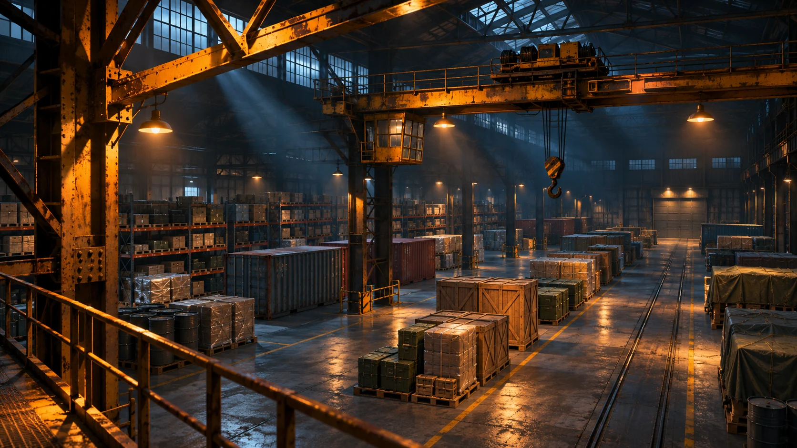<br />
      <b>WAREHOUSE</b> · 17 × 17<br />
      Close quarters between the shelves. Short lanes, fast fights.
    </td>
    <td>
      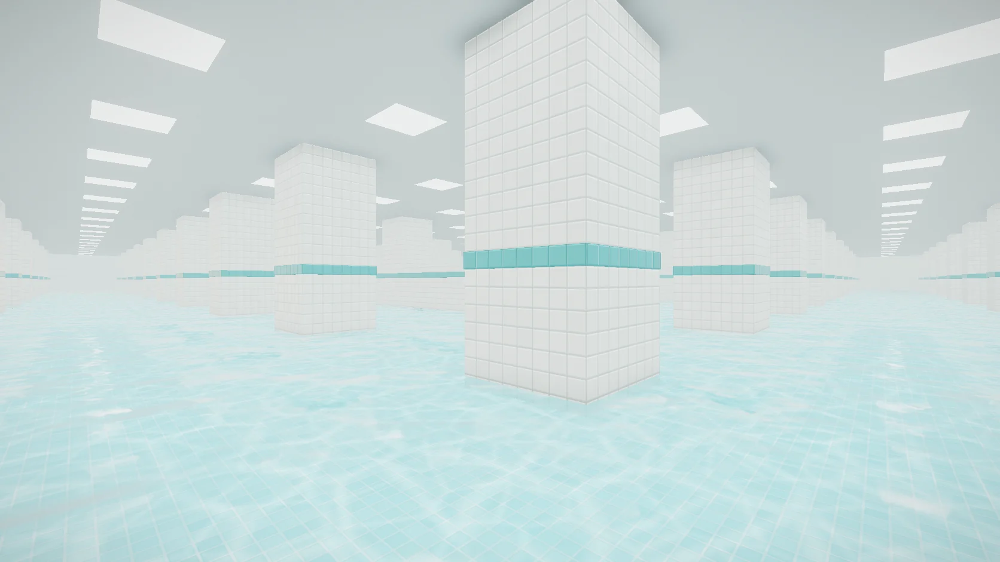<br />
      <b>POOL</b> · 21 × 21<br />
      Endless white tile and ankle-deep water. Wade through canals with ripples and caustics at your feet.
    </td>
  </tr>
  <tr>
    <td>
      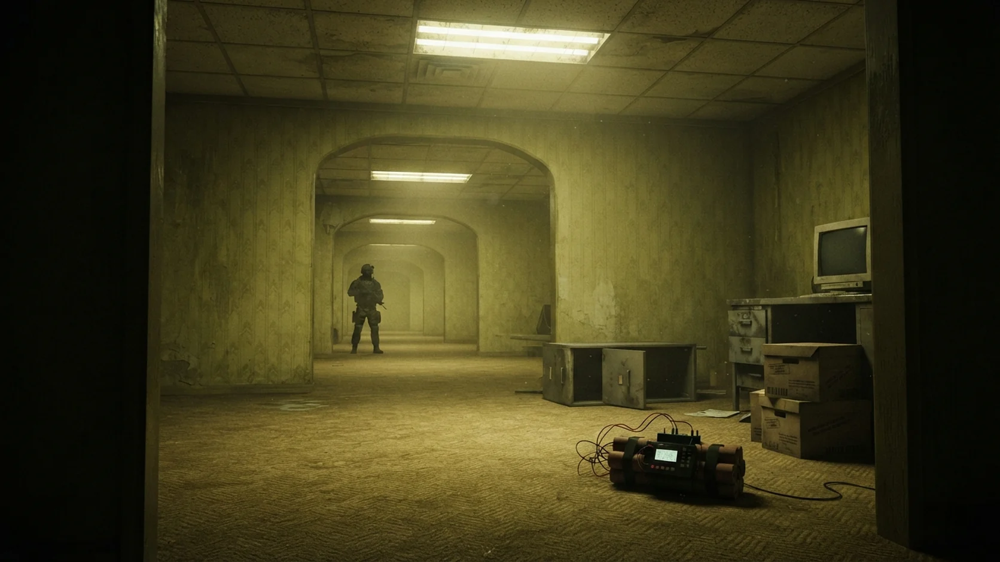<br />
      <b>BACKROOMS</b> · 21 × 21<br />
      Yellow rooms without end. The lights stutter, and every half minute the walls move.
    </td>
    <td>
      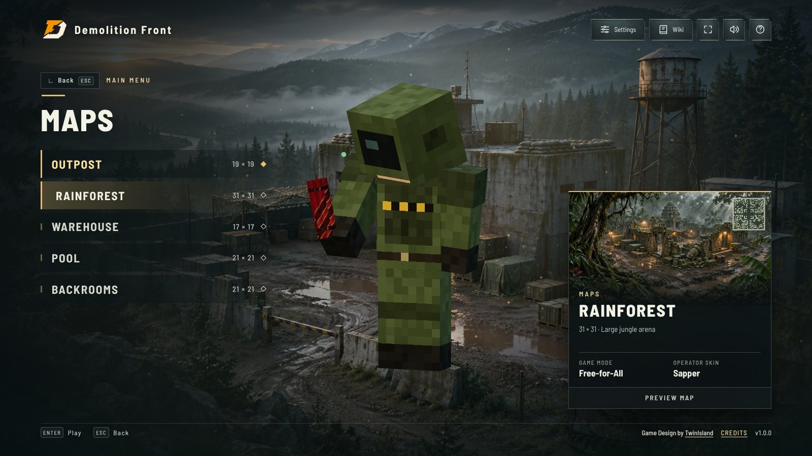<br />
      <b>YOUR MAP HERE</b><br />
      Maps are self-contained modules. The <a href="docs/modding/maps.md">map modding guide</a> shows how to add one.
    </td>
  </tr>
</table>

## Build your operator

### Skills

Spend your starting coins on up to four skills before you deploy.

<table>
  <tr>
    <td align="center" width="16%">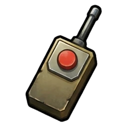<br /><b>Remote Detonator</b><br /><sub>Set off all your charges at once</sub></td>
    <td align="center" width="16%">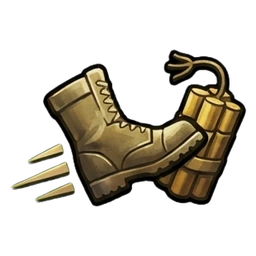<br /><b>Slide Kick</b><br /><sub>Kick a charge down the lane</sub></td>
    <td align="center" width="16%">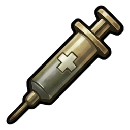<br /><b>Med Injector</b><br /><sub>Heal 30 HP over 3 seconds</sub></td>
    <td align="center" width="16%">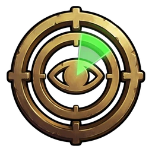<br /><b>Threat Scan</b><br /><sub>See everyone through cover</sub></td>
    <td align="center" width="16%">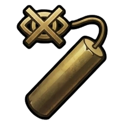<br /><b>Blind Fuse</b><br /><sub>Hide your blast paths</sub></td>
    <td align="center" width="16%">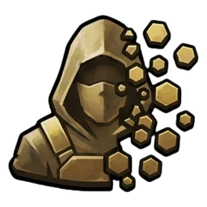<br /><b>Optical Camo</b><br /><sub>Turn invisible for 6 seconds</sub></td>
  </tr>
</table>

### Perks

Score is experience. Every level-up adds a fixed boost and deals you three perk cards in Silver, Gold, Diamond or Mythic. They stack for the rest of the match, so no two runs play the same.

<table>
  <tr>
    <td align="center" width="20%">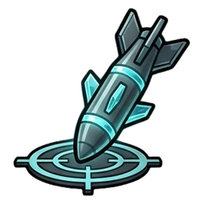<br /><b>Missile Strike</b><br /><sub>Diamond · call a missile onto any tile; it ignores walls</sub></td>
    <td align="center" width="20%">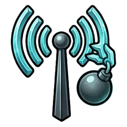<br /><b>Hijack</b><br /><sub>Diamond · take over every enemy charge chained to yours</sub></td>
    <td align="center" width="20%">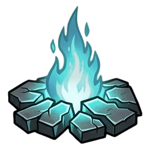<br /><b>Cataclysm</b><br /><sub>Diamond · rearrange the arena and sweep it with fire</sub></td>
    <td align="center" width="20%">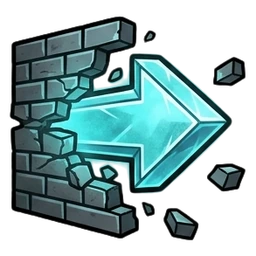<br /><b>Piercing Charge</b><br /><sub>Diamond · blasts punch through one obstacle</sub></td>
    <td align="center" width="20%">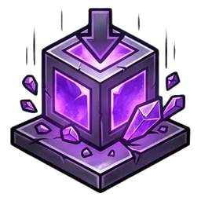<br /><b>Dimensional Collapse</b><br /><sub>Mythic · lock everyone else in the overhead view</sub></td>
  </tr>
</table>

<p align="center">
  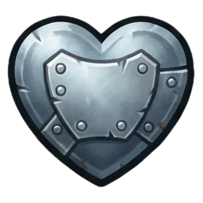
  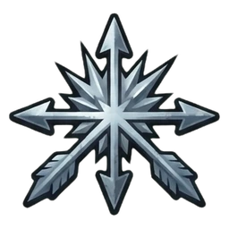
  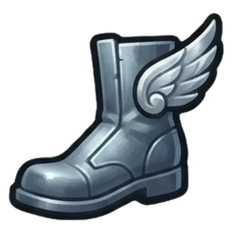
  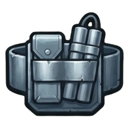
  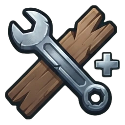
  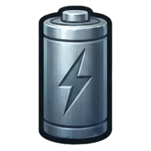
  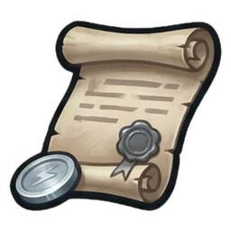
  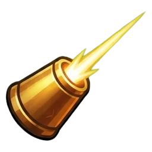
  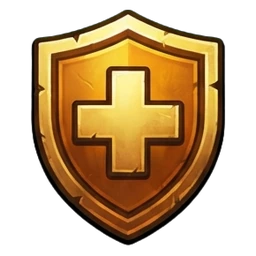
  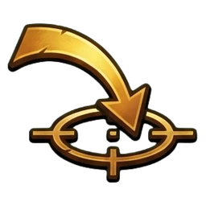
  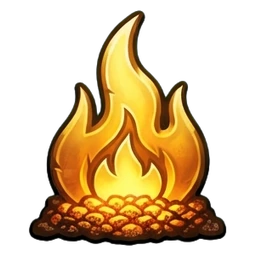
  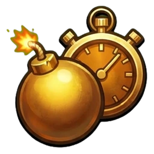
  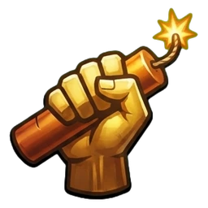
  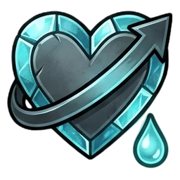
  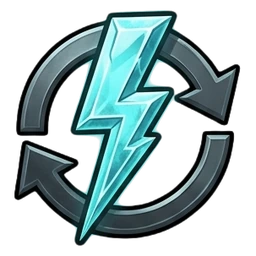
  <br />
  <sub>Twenty perks in all. Each has a page in the <a href="docs/content/README.md">content reference</a>.</sub>
</p>

### Gear and mutations

Cover and zombies drop gear. Zombies sometimes also drop a gene mutation that permanently raises one of your stats.

<p align="center">
  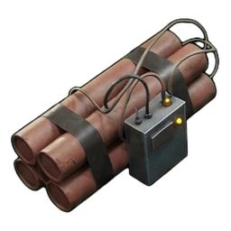
  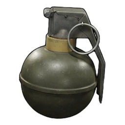
  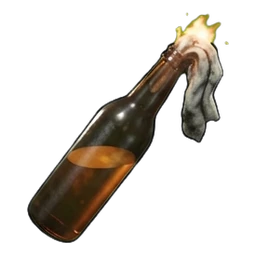
  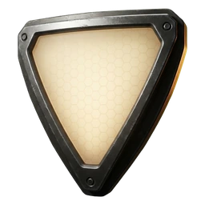
  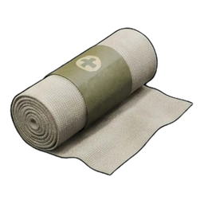
  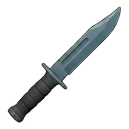
  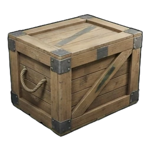
  &nbsp;&nbsp;&nbsp;
  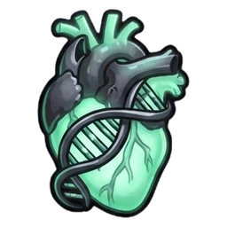
  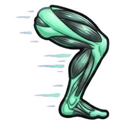
  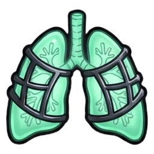
  
  
</p>

### Operators

Pick a built-in operator or import any Minecraft skin PNG, then choose a finish for your charges.

<table>
  <tr>
    <td width="50%"></td>
    <td width="50%"></td>
  </tr>
</table>

## Four ways to play

| Mode | What changes |
| --- | --- |
| **Free-for-All** | The standard rules, in first person. Last operator standing wins. |
| **Classic** | The whole match on a top-down 2D board, like the original. |
| **Wild** | Everyone starts overpowered: more health, power and range, faster level-ups, and health that regenerates out of combat. |
| **Practice** | No clock. Go in alone if you like and learn the maps and skills. |

When it is over, the result screen breaks down the match: placement, medals, and what everyone did with their charges.

<p align="center">
  
</p>

## Controls

| Action | Input |
| --- | --- |
| Move, look | WASD, mouse |
| Sprint | Hold Shift |
| Jump | Space |
| Plant a charge, use or throw gear | Left click |
| Build a wooden crate | Right click |
| Skills | E, F, C, Z, Q |
| Pick a perk | 1, 2, 3 |
| Trigger an active perk / switch to the next | T / G |
| Gear wheel, supply wheel | Hold V, hold B |
| Pause | Esc |

Every key can be rebound in the in-game manual.

## Run it locally

Requires Node.js 20.19+ or 22.12+.

```sh
npm ci
npm run dev
```

## Docs and modding

Maps, skins, bomb finishes, skills, items, perks and mutations are all self-contained modules.

- [Wiki](docs/README.md): game rules, drop rates, and a page for every skill, item, perk and mutation.
- [Modding guide](docs/modding/README.md): make your own maps and content packs.
- [Developer guide](docs/developer-guide.md): working on the game itself.
- [Desktop build](docs/desktop.md): Windows and macOS apps built with Tauri, released from GitHub Actions.

## Credits

Game design by [TwinIsland](https://tianyihuang.com). Third-party assets and their licenses are listed in [CREDITS.md](public/assets/CREDITS.md). The equipment, bomb and knife 3D models were generated with Meshy 7.5; icons and key art were generated with Google Gemini and OpenAI ImageGen.
