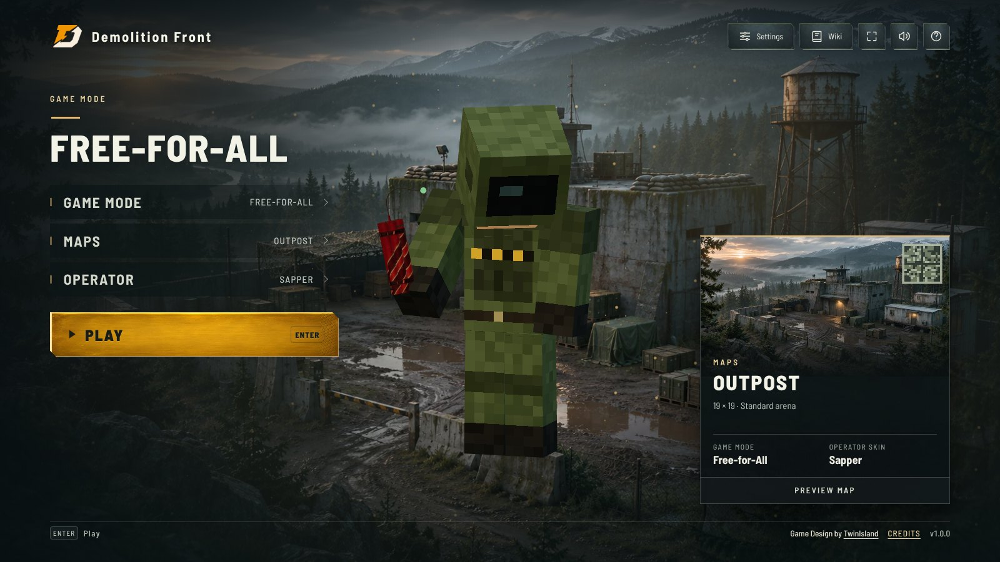

# Demolition Front wiki

Welcome to the wiki for **Demolition Front** (爆破前线), a first-person bomb-arena game with roguelite character building. It covers how to play, the numbers behind every rule, and how to mod and develop the game.

## Playing

| Page | What it covers |
| --- | --- |
| [How to play](playing.md) | A match from start to finish, controls, views, modes |
| [Game rules](game-rules.md) | Safe zone, health, damage, score, coins, crates, supply shop, zombies |
| [Content reference](content/README.md) | Tables of every skill, item, perk and mutation, each linked to its own page |
| [Probabilities](probabilities.md) | How perk offers, loot drops, zombies and mutations are rolled |

## Modding

| Page | What it covers |
| --- | --- |
| [Modding overview](modding/README.md) | Installing packs, pack layout, IDs, translations, sounds |
| [Map mods](modding/maps.md) | Map setup, random generation, obstacle presets, terrain reshuffle |
| [Item mods](modding/items.md) | Gear, throwables, melee, drop weights |
| [Skill mods](modding/skills.md) | Active and passive skills, hooks, stats |
| [Perk mods](modding/perks.md) | Passive and active perks, tiers, eligibility |
| [Other packs](modding/other-packs.md) | Mutations, skins, charge finishes |

## Development

| Page | What it covers |
| --- | --- |
| [Developer guide](developer-guide.md) | Setup, project layout, how a match runs, bots, release |
| [Architecture](architecture.md) | Data flow, sessions, online play design (Chinese) |
| [Performance](performance.md) | Profiling notes (Chinese) |

## About this wiki

The pages are Markdown files in `docs/`, readable as they are and published as a website with VitePress. Preview with `npm run dev:wiki`. The pages under `content/` are generated: after changing a module's numbers, run `node docs/tools/build-content.mjs`.
