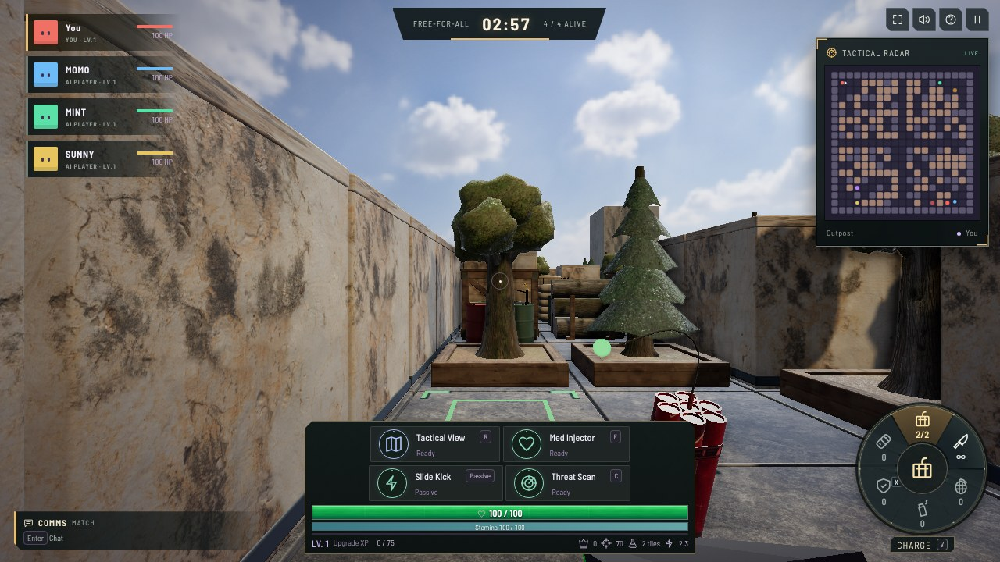
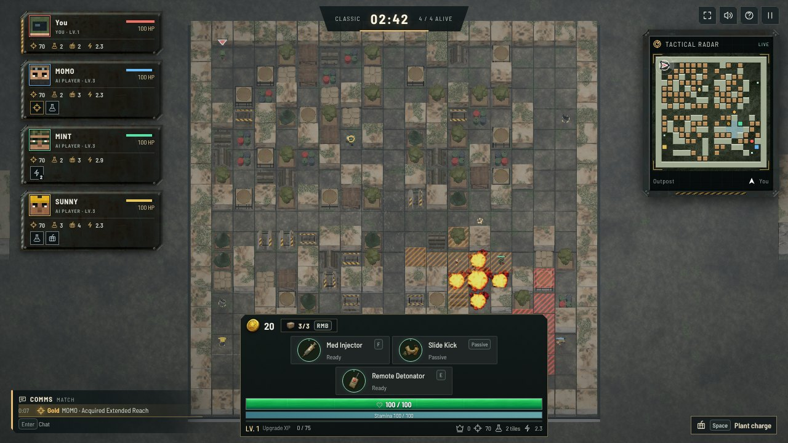

# How to play

**Demolition Front** (爆破前线) is a first-person bomb-arena game with roguelite character building. You are dropped into a grid arena with up to three AI opponents. Plant charges, blow open cover, and trap the others in the cross-shaped blast. The last operator standing wins.

## A match

1. **Set up the room.** Pick a map, a mode, one to three bots with their difficulty, the zombie rate and the match duration.
2. **Buy skills.** You start with coins for up to four [skills](content/README.md#skills). Coins you keep can be spent in the supply shop during the match.
3. **Fight.** Destroying cover, hitting opponents and killing zombies earns score and coins.
4. **Level up.** Score fills a level bar. Each level offers three [perks](content/README.md#perks) and you keep one. They last for the match.
5. **Survive the zone.** The outer wall closes in ring by ring, see [Safe zone](game-rules.md#safe-zone). The last one alive wins.

## Controls

Every key can be rebound in the in-game manual.

| Action | Default |
| --- | --- |
| Move | W A S D |
| Look | Mouse, or ← → to turn |
| Sprint | Left Shift (hold) |
| Jump | Space |
| Plant a charge, use or throw gear | Left click |
| Build a wooden crate with coins | Right click |
| Next / previous gear | Mouse wheel |
| Gear wheel | V (hold) |
| Equip shield | X |
| Skills | Q Blast Surge, E Remote Detonator, R Tactical View, F Med Injector, C Threat Scan, Z Blind Fuse, X Optical Camo |
| Pick perk 1 / 2 / 3 | 1, 2, 3 |
| Expand perk cards | Tab |
| Trigger an active perk, choose which | T, G |
| Supply wheel | B (hold, slide to an item, release to buy) |
| Reshuffle cover (Practice) | P |
| Chat | Enter |
| Pause | Esc |
| Fullscreen, performance panel | F10, F8 |

## Views

The game is first person. The [Tactical View](content/skills/shift.md) skill switches to a top-down view that plays like the classic genre: four-way movement, Space plants a charge on your own tile.

## Modes

| Mode | Rules |
| --- | --- |
| Free-for-All | The standard match |
| Wild | Everyone starts oversized: 300 HP, range 4, 10 charges, and perk offers twice as often. See [Game rules](game-rules.md#operator) |
| Practice | No opponents needed, you take no damage, no zone, and P reshuffles the cover |

## Things to know

- Your own charge still hurts you, for a fifth of its power.
- Grenades and smoke grenades always show their arc and landing tile while equipped. Aim with the mouse and left-click to lob over cover.
- Cover drops gear more often the longer you go without a drop, and more often when you are hurt or empty-handed. See [Probabilities](probabilities.md).
- The [knife](content/items/knife.md) is always with you. Two strikes break cover or kill a zombie.
- A [shield](content/items/shield.md) blocks one whole explosion. It does nothing against the final firestorm.
- Level 3 zombies always grant a [mutation](content/README.md#mutations).
- Right-click to spend coins building a wooden crate ahead. Built crates block blasts and can seal a lane or cover a retreat. They are not carried or sold in the supply shop.
